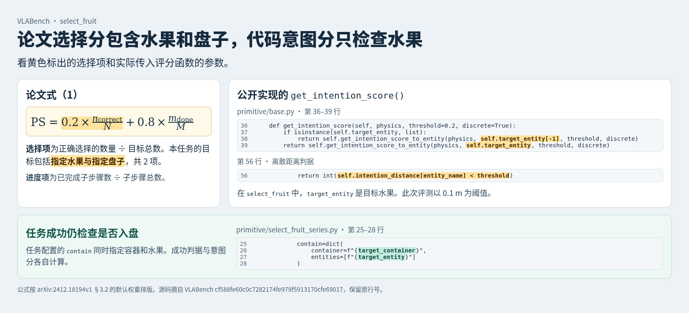

# VLABench 单任务复现与桌面纹理对照

本次单任务复现与 10 对桌面纹理探索已完成：相机适配入口下，正常桌面成功 **6/10**，固定变化纹理成功 **2/10**；4 对从成功变为失败，2 对均成功、4 对均失败，没有反向改善样本。首场景的 500 步同条件重复逐位一致，20 条正式轨迹共 7,540 步，未出现运行异常。

论文 PS 的选择项包含目标水果和目标容器，公开代码的意图分只检查是否接近目标水果。任务成功条件仍检查水果是否进入目标容器。第 4 节用标注图并排展示公式和关键源码行，并保留 5 张原始源码截图及版本散列。本文分开报告官方成功、代码意图分和步骤进度，`paper_ps = null`。

本文用于课程汇报中的复现记录与后续实验衔接；论文内容见 [[02-Papers/VLABench - A Large-Scale Benchmark for Language-Conditioned Robotics Manipulation with Long-Horizon Reasoning Tasks.md|VLABench 论文阅读笔记]]。这里仅将保存了运行收据的结果列为已完成。

## 论文实验与本次复现的关系

VLABench 论文分别评测了直接输出动作的 VLA 策略、组合感知和规划模块的工作流，以及生成操作计划的视觉语言模型。本次实验对应第一类。论文第 4.1 节用仿真示范微调 OpenVLA、Octo 和 RDT-1B，比较它们在已见与未见物体类别、不同指令、相似新任务和复合任务中的表现。表 2(a) 的 `Select Fruit` 就是本次选用的任务，要求机械臂根据指令把指定水果放入指定容器。[论文 §4 与表 2(a)](https://arxiv.org/html/2412.18194v1#S4)

| 对照项 | 论文实验 | 本次复现与补充 |
| --- | --- | --- |
| 任务与模型 | 多个任务，比较微调后的 OpenVLA、Octo、RDT-1B | 沿用 `select_fruit` 的仿真任务，使用公开的 LeRobot SmolVLA 权重做单任务推理 |
| 视觉变化 | 基准支持桌面、墙面、地板纹理及光照等随机变化。表 2(a) 中 `Select Fruit` 比较已见与未见物体类别 | 选定 10 个初始场景，每对固定指令、初始状态、物理参数和策略随机数，只替换桌面纹理，观察同一场景的结果是否变化 |
| 结果怎么读 | 论文用进度分 PS 报告多模型的泛化表现 | 以代码的入盘判据统计逐对成功情况，另报告意图分和步骤进度。模型、对照条件和指标均有差异，两个成功率属于本次配对实验 |

纹理变化本身是原基准支持的变量。本次补充的是把桌面纹理**单独拿出来做同场景配对**，再用逐步日志判断差异体现在哪个任务阶段。[论文 §6.3](https://arxiv.org/html/2412.18194v1#S6.SS3) · [本次策略权重](https://huggingface.co/lerobot/smolvla_vlabench/tree/7ef370813eb35823caa94088b50f5389a51e4c47)

课堂上交代完这张对照表，可以用一句话进入本次实验。

> 我用公开的 SmolVLA 权重执行水果入盘任务，核对相机输入、机械臂动作与环境入盘判定，再用 10 对同起点实验观察只换桌面纹理时，机器人能否完成同一操作。

接下来先看[[#5.3 十对结果与评分分项|逐对结果图]]，再用[[#5.4 第 2 对样本的画面证据|第 2 对的终态画面和步数]]说明抓取标记与最终入盘的区别。环境和入口细节留作复现记录。

## 0. 21 页课堂 PPT 的串讲入口（2026-11-14）

> 当前成品已更新为23页，见§0.2；下述21页索引保留为原带读页码，按新旧映射继续使用。

当前汇报为 `E:\ppt生成\VLABench_课堂交流_20261113\exports\VLABench_课堂交流_史涵业.pptx`，本轮回读 21 页。论文阅读路线和学习目标在 [[02-Papers/VLABench - A Large-Scale Benchmark for Language-Conditioned Robotics Manipulation with Long-Horizon Reasoning Tasks#0.2 当前 PPT 与证据边界（2026-11-14）|论文笔记 §0.2–0.5]]；本页继续保存实验方法、结果和固定版本依据。

| PPT | 对应本页 | 讲述重点 |
| --- | --- | --- |
| 01–03 | 论文实验与本次复现的关系 | 前期L侧共性、原论文L/V范围与精讲理由；不把三篇文献当VLABench内部模块 |
| 08–10 | §1；论文§4.1、§9.1；§5.1 | 作者4张80GB A800与本地单张4070约12GB分开；公开策略推理与本次V侧纹理对照 |
| 11–12 | §2–3 | 相机适配、诊断样本及不能推断的适配收益 |
| 13–14 | §5.1–5.2 | 配对恢复与同条件完整重复 |
| 15–16 | §5.3–5.4 | 十对结果、p=0.125和橙子个案 |
| 17–18 | §4、§5.3 | 论文PS、接近、历史抓取与当前入盘 |
| 19–21 | §5.5；下文计划 | 未执行的视觉条件扩展、过程诊断与范围收束 |

P02 的两句中文是语义保持的讲解示意；本轮没有另做语言改写实验。`seed=2001` 的真实记录指令为 `Put the orange into the plate_seen`。三篇语言工作分别涉及释义评测、任务相关失效表述搜索和指定替代目标的轨迹重定向，不按同一语义保持标准或同一攻击目标合并。

“同一起点”只要求每对执行开始时匹配；后续动作和状态可以因视觉输入不同而分开。纹理改的是渲染像素；物理模型数组和状态核验用于检查没有同时改动物理配置。观察到 V 侧条件下失败，不等于已证明视觉编码器或某个内部模块是根因。

**后续计划（尚未执行）。** P19 先增加场景、纹理和策略重复，再分别测试光照、背景、相机视角，每轮限定因素并检查目标可见性和任务可执行性；跨到 LIBERO-Plus 前核对策略接口与官方成功判据。P20 将四条由成转败的变化轨迹与各自正常轨迹对齐，记录夹爪接触和水果相对位移、相对盘子位置、松爪时刻与落点，寻找稳定差异。持稳、搬运、释放是待检验的失败解释，均未确认为当前根因。

作者多模型微调配置不是最低硬件要求；本次未重训模型，沿用公开检查点的单任务推理和10对配对结果。

本轮修订回读实际21页PPTX、Notes、PDF、现存JSON和脚本相关分支；原来的运行收据仍对应其记录日期，未重新执行实验、复播全部视频或确认用户已掌握。修订前全文备份为 `E:\ppt生成\VLABench_课堂交流_20261113\backup\20261114-before-guided-reading\experiment-note.md`。

本轮细节优化保持21页：P03为引入、P07呈现两组结果表；本机硬件取舍、配对观察和后续过程分析采用课堂汇报视角。正文移除出处编号与抽象免责声明，既有实验数据、判据和版本记录保持原口径。封面补齐论文原题后，带读按用户要求从封面重新开始。

### 0.1 带读后PPT统一优化（2026-11-15）

已把带读中的必要解释和原生PPTX补充回填制作源，重新排版并生成21页PPTX、PDF及全稿预览，入口保持不变。第8页区分公开权重推理与后续扩展；第9页首次定义入盘次数、代码距离分和步骤进度；第11页交代训练视角与输入匹配的理由；第12页明确香蕉缺少同起点原入口对照；第13–14页分别解释配对恢复与同条件重跑；第17–18页用定义和算例解释评分差异及均值。第19–21页区分实际完成、过程线索与计划。

本次没有训练、微调或新增轨迹。模型配置与读音备问继续保留在§1.1–1.2，三次诊断及正式20条轨迹的归属不变。论文带读笔记§0.17保存逐段采用情况；项目`validation/delivery-review.json`保存当前PPTX/PDF散列和实际验收结果。21页实际PowerPoint渲染、21页备注，页面/模块溢出及PDF文字行碰撞候选均为0；排练和课堂投影未测。

### 0.2 全稿解释完整性返修与新页码（2026-11-15）

当前成品为23页，沿用原成品路径；上一版21页已完整备份。此次对全部页面按带读笔记审查，修订不局限于开头。新增03–04的角色与基准选择解释，将原07拆为08–09两页，后续实验页相应顺延：原08–14→当前10–16，原15–18→当前17–20，原19–21→当前21–23。

实验部分补清：距离分的主体是末端；恢复应清除上一条动作残留；变化条件的8次失败中4对正常也失败；进度最高1，同为0.5可以对应不同标记状态；视角扰动保持训练输入槽位含义，与修正错接不同；以橙子首次抓取80/74步说明事件对齐的理由。原20条正式轨迹、分项均值和诊断归属不变。详细参数和环境备问仍在§1.1–1.2。

逐页采用表见项目`analysis/production_decisions.md`，论文笔记§0.18保存页码映射；当前技术收据为`validation/delivery-review.json`，语义与视觉复核为`validation/full-explanation-review.json`。23页及23页Notes已同步，页面/模块溢出与PDF文字行碰撞候选为0。以上是内容采用与文件核验，不等于已验证现场理解或新增实验结论。

**最终确认（2026-11-15）。** 当前23页版已确认为本次最终版，三份成品散列保持既有验收身份。随后只更新共享Skill及排版/工作区规则，并同步确认记录；未新增模型或机器人实验。收据见项目`validation/final-acceptance.json`。

## 1. 复现范围与固定环境

目标是先完成 `SmolVLA + select_fruit` 的正常单次运行，再用 10 个初始场景做正常桌面/变化纹理的配对探索。只测试单任务，不训练模型，也不运行完整任务集。

Linux 实验目录为 `/home/user/paper/vlabench-repro`；这些路径属于 Linux 复现环境，不是 Windows 知识库的运行入口。

| 项目 | 实际配置 |
| --- | --- |
| 硬件 | NVIDIA GeForce RTX 4070，显存 12282 MiB；驱动 535.309.01 |
| 环境 | 项目 `.venv`，Python 3.12.13；177 个包的依赖一致性检查通过 |
| 计算与仿真 | PyTorch 2.7.1+cu118，torchvision 0.22.1+cu118；MuJoCo 3.2.2，dm-control 1.0.22；EGL 实际渲染通过 |
| LeRobot | 0.7.1；源码 `81b8c5bfdd5591ec59e512cfc7ac6db8151c70ee` |
| VLABench | `cf588fe60c0c7282174fe979f5913170cfe69017` |
| RRT | `e51d95ee489a225220d6ae2a764c4111f6ba7d85` |
| 策略 | `lerobot/smolvla_vlabench@7ef370813eb35823caa94088b50f5389a51e4c47` |
| 视觉语言基础模型 | `HuggingFaceTB/SmolVLM2-500M-Video-Instruct@7b375e1b73b11138ff12fe22c8f2822d8fe03467` |
| 资产 | `lerobot/vlabench-assets@08d7a4479a55c8fbb89ac0fd6fcf06e53d65b4a4`；单任务清单 6501 个文件，2,581,576,390 bytes；完整性门禁通过 |

官方 Google Drive 下载脚本曾返回下载限制，随后采用 LeRobot CI 指定的 Hugging Face 资产镜像。策略及基础模型均按固定版本下载，SHA-256 已核对；严格模型加载、CUDA 推理与真实任务创建通过。`env.sh` 指定本地缓存、`HF_HUB_OFFLINE=1`、`MUJOCO_GL=egl` 和 `PYOPENGL_PLATFORM=egl`。

精确版本和权重散列保存在 [[VLABench-repro-versions-initial.json|版本收据]]，实测计算与渲染信息见 [[VLABench-repro-gpu-egl.json|CUDA/EGL 收据]]；完整依赖锁文件保留在实验目录的 `requirements.lock.txt`。

### 1.1 模型配置与课堂备问（2026-11-14补充核对）

本节补足口头答辩所需配置，不表示本次重新训练或重新运行。依据为固定检查点配置、Hub同revision参数元数据、固定LeRobot源码及已有运行协议。SmolVLA口头可读作“斯摩尔 V—L—A”（后面三个字母分别读）；这是便于课堂交流的读法建议，不声称官方指定发音。首次可介绍为“轻量级视觉—语言—动作模型SmolVLA”。

| 项目 | 本次固定配置及含义 |
| --- | --- |
| 策略检查点 | `lerobot/smolvla_vlabench@7ef370813eb35823caa94088b50f5389a51e4c47` |
| 参数量 | Hub该revision元数据总计450,046,176，约4.5亿（0.45B）；不是把基础VLM名称中的500M直接当成本策略精确总量 |
| 基础VLM配置 | `HuggingFaceTB/SmolVLM2-500M-Video-Instruct`；策略配置使用16层VLM等结构设置 |
| 本次参数更新 | 无；加载已有权重并以eval/inference模式运行 |
| 观测历史 | `n_obs_steps=1`，一次观测时刻；不表示只有一路相机 |
| 图像 | 前方、右侧、腕部3路；环境画面480×480，模型内部按`resize_imgs_with_padding=[512,512]`缩放补边；配置feature声明为3×224×224，不据此误报实际内部处理尺寸 |
| 状态输入 | 7维：机器人基座坐标中的末端位置3维、xyz欧拉角3维、夹爪开合1维 |
| 语言输入 | 当前任务指令；`tokenizer_max_length=48`为配置值，不等于48个中文字 |
| 动作输出 | 每步7维：末端目标位置3维、xyz欧拉角3维、夹爪开合1维；不是7个关节角 |
| 控制接口 | 默认`action_mode=eef`，沿用既有适配器将目标位姿通过逆运动学转成机械臂关节控制，并控制夹爪 |
| 动作块 | `chunk_size=50`、`n_action_steps=50`；生成50步动作，队列逐步执行，耗尽后再生成下一段，提前成功则停止 |
| 生成迭代 | `num_steps=10`，动作生成中的迭代次数；不是任务只执行10步或本次训练10步 |
| 数值设置 | CUDA、`use_amp=false`、正式配对TF32=true；不能将关闭AMP解释成所有权重均为FP32，checkpoint含BF16与F32张量 |
| 评测上限 | 每条500个环境动作步，首次满足入盘即停；不是500次完整动作块推理 |
| 样本 | 场景seed2000–2009，配对策略seed4000–4009；10对20条正式轨迹，另有首场景同条件核验1条 |

**输入输出的一轮。** 三路画面＋7维末端状态＋指令→预处理与策略→50×7动作块→逐步取出7维动作→既有末端位姿到关节控制适配→环境更新并检查成功。虽然外层每步取得新观测并记录，动作队列未耗尽时通常不会重新生成整段动作，因此不能宣称本次每步都基于新图像重规划，也不将录制10fps等同于实测推理10Hz。

**上游训练设置与本次运行分开。** 随附`train_config.json`标示dataset为`lerobot/vlabench_unified`、训练配置20,000 steps、batch_size=32。这是公开权重随附配置，不是本次训练工作，也不能单凭配置证明上游实际完成了全部训练过程。本次未训练，课堂主体优先说清已有权重的来源和本次推理配置。

**相机为什么需要适配。** 公开preprocessor将`image/second_image/wrist_image`依次映射至`camera1/camera2/camera3`。检查训练视频与仿真相机后，三个槽位应接前方、右侧、腕部；原入口按0/1/2取帧时接成右、左、前，第三槽缺少腕部图像。适配后的索引2/0/3在本次两种桌面中一致。该证据支持输入视角匹配的必要性，不证明适配是所有失败的唯一原因或已经测得成功率提升。

**老师问工作做在哪里，可按实际顺序回答。** 准备固定版本环境及任务资产、加载公开权重；检查训练与运行的输入输出接口，完成相机对应适配；用三条诊断运行核对实际动作与入盘判断；保存并恢复初始状态、重置策略随机种子和动作队列；做首场景同条件完整重跑；执行10对纹理实验；保存动作、状态、图像、评分并分析入盘结果和分项。复用框架功能、适配工作及实验观察分别归属，不宣称重新开发了仿真器、模型或新指标。

证据附件：[[VLABench-repro-checkpoint-config.json]]、[[VLABench-repro-checkpoint-info.json]]、[[VLABench-repro-checkpoint-train-config.json]]、[[VLABench-repro-checkpoint-preprocessor.json]]；[固定检查点config](https://huggingface.co/lerobot/smolvla_vlabench/blob/7ef370813eb35823caa94088b50f5389a51e4c47/config.json)、[固定参数元数据](https://huggingface.co/api/models/lerobot/smolvla_vlabench/revision/7ef370813eb35823caa94088b50f5389a51e4c47)、[固定LeRobot适配器](https://github.com/huggingface/lerobot/blob/81b8c5bfdd5591ec59e512cfc7ac6db8151c70ee/src/lerobot/sim/integrations/vlabench.py)、[动作队列实现](https://github.com/huggingface/lerobot/blob/81b8c5bfdd5591ec59e512cfc7ac6db8151c70ee/src/lerobot/policies/smolvla/modeling_smolvla.py)。本轮通过公开URL实际取回上述配置及源码，版本与运行收据一致；未下载权重或重新执行模型。

### 1.2 MuJoCo、dm_control与EGL分别负责什么（2026-11-14备问）

可以将本次环境表述为“基于MuJoCo的VLABench仿真任务，通过dm_control组织环境交互，使用EGL支持后台无窗口渲染”。本次已有版本记录为MuJoCo3.2.2、dm-control1.0.22，EGL为渲染后端设置，不作为另一套物理引擎。MuJoCo课堂可分Mu–Jo–Co三个音节读，英文提示为moo–joe–koh，中文近似“穆—乔—扣”；名称来自Multi-Joint dynamics with Contact。这是中文近似发音提示，不代替正式音标。

| 层次 | 对象 | 在本次实验中的职责 |
| --- | --- | --- |
| 任务与评测 | VLABench | 组织机械臂、物体、场景、任务指令及成功条件 |
| 环境组织和交互 | dm_control | 提供基于MuJoCo的Python环境工具，支持初始化、观测、动作推进及任务逻辑的组织 |
| 物理计算 | MuJoCo | 根据模型、控制与接触等条件更新关节及物体的位置、速度等物理状态 |
| 渲染运行条件 | EGL | 管理图形上下文等，支持本次不打开可见窗口的硬件渲染；图像仍由渲染器生成 |
| 动作策略 | SmolVLA | 根据允许的观测和指令产生动作 |

讲解示意：模型要求夹爪向水果移动并闭合后，MuJoCo计算是否接触、物体怎样运动；渲染器从更新后的场景生成相机图片，本次通过EGL在后台完成渲染。物理更新与画面生成是相互关联但不同的工作。桌面纹理改变画面外观；本次另核对碰撞、质量、摩擦等物理模型配置未随之改变。使用dm_control不等于本次进行了强化学习；这是环境工具的用途与实际训练方式的区别。

依据：[MuJoCo官方概览](https://mujoco.readthedocs.io/en/stable/overview.html)、[dm_control官方仓库及渲染说明](https://github.com/google-deepmind/dm_control#rendering)、[EGL官方说明](https://www.khronos.org/egl/)，以及已保存的CUDA/EGL版本收据。官方当前文档用于解释职责，不将当前新版能力反填为本次旧版本已使用的功能。

## 2. 官方入口与本地适配

运行顺序为：资源与版本门禁 → CUDA/EGL/模型加载 → 原始 `lerobot-eval` 单次运行 → 根据失败证据检查接口 → 相机适配及正常样本诊断 → PS 与配对恢复核验 → 正式视觉对照。

原始入口确实运行过，结果是 seed=1000 的 500 步失败。当前本地入口保留两个源码差异：

| 改动 | 依据与影响 | 保存的差异 |
| --- | --- | --- |
| `VLABench/configs/constant.py`：不存在的资产目录返回空列表 | 兼容单任务资产集合；任务所需资产仍由完整性门禁检查 | [[VLABench-repro-asset-discovery.patch]] |
| LeRobot 图像输入顺序由 `(0,1,2)` 改为 `(2,0,3)` | 编译相机实际为 `0=right`、`1=left`、`2=forward`、`3=franka/Franka_wrist_cam`；检查点训练视频对应前方、右侧、腕部，保留原三路 rename 键名 | [[VLABench-repro-camera-order.patch]] |

相机核验使用检查点 `train_config.json` 指定的 `lerobot/vlabench_unified`，固定到 `f61ad898199e746c20af3112f278cc86eb3ca3c4`，对照实际训练视频首帧与仿真相机画面。依据与帧散列见 [[VLABench-repro-camera-mapping.json]]。索引映射依赖当前版本和相机枚举，升级后需重新核对。

当前正常入口为实验目录下的 `bash run_baseline.sh`：单环境、同步、1 episode、CUDA、默认 seed=1000；检查点动作块为 50，采样迭代数为 10，任务上限 500 步。入口会保存实际命令、环境、源码差异、日志、评测 JSON 和视频。相机适配后的结果按本地适配方案记录。

## 3. 已保存的三次诊断运行

| 条件 | seed | 指令目标 | 步数 | 官方任务判据 | 结果收据 |
| --- | --- | --- | --- | --- | --- |
| 原始相机顺序 | 1000 | apple → plate_seen | 500 | 失败 | [[VLABench-repro-original-seed1000-eval.json]] |
| 相机适配 | 1000 | apple → plate_seen | 500 | 失败 | [[VLABench-repro-adapted-seed1000-eval.json]] |
| 相机适配，原生逐帧记录 | 1001 | banana → plate_seen | 139 | 成功 | [[VLABench-repro-adapted-seed1001-eval.json]]、[[VLABench-repro-adapted-seed1001-protocol.json]] |

三次进程均退出 0，任务结果分别为失败、失败、成功。退出码证明进程完成，任务成功由环境判据单独判断；`get_reward()` 固定返回 0，reward=0 不用作失败依据。

原始结果目录依次为：

```text
outputs/baseline-20261110T043532Z-kzxFa1
outputs/baseline-20261110T095207Z-H3kXKd
outputs/diagnostic-seed1001-20261110T095510Z-cs0Ry1
```

seed=1001 样本保存了原生 state/action 数据和三路视频，末条数据同时为 `next.success=true`、`next.done=true`。视频均为 480×480、10 fps、139 帧；此前正面视频检查可见抓起香蕉并向盘子移动。此记录方式保存动作前观测，缺少最后一步动作后的额外终态画面；`eval_info.json` 的 `video_paths=[]` 对应该次采用原生 recording，视频实际位于 `recordings/select_fruit_0/videos/`。

这三次用于入口诊断，不合并为成功率统计。seed=1000 在相机适配后仍失败；seed=1001 更换了场景，不能把两者差异归因于相机修复。正常单次样本已通过官方任务判据；这三次诊断不计入第 5 节的 10 对正式探索。

### 3.1 香蕉为什么没有原入口对照（2026-11-14追问）

FACT：现存记录中只有seed1000苹果的原入口/适配两条，以及seed1001香蕉的适配一条，没有保存香蕉原入口分支。seed是在固定环境和版本中初始化场景的随机种子，数字1001本身不是香蕉类别编号。

UNRESOLVED：当时为何没有补跑该分支，已有材料未记录明确理由，不能补造节省时间或算力的动机。已保存的香蕉运行作为一个当前配置可完成任务的诊断样本报告，不能回答原入口在同一香蕉起点是否也能成功。

若研究问题是“相机适配是否提升执行”，应在相同起点下比较原入口与适配入口，并扩展场景/重复；这与目前两分支都采用适配入口、只比较桌面纹理的正式实验是另一项对照。缺少香蕉原入口不使其成功记录失效，但限制了相机适配收益的解释。用户本轮只要求讲解，未补跑该对照。

## 4. PS 论文定义与代码差异



先看黄色标注。论文式（1）的 $0.2\times n_{correct}/N$ 把**目标水果和目标盘子**都纳入选择分。右侧源码第 **36–39 行**的评分调用只传入 `target_entity`，本任务里它是**目标水果**。绿色标注里的 `contain` 同时指定水果和盘子，用于判断任务是否成功。

### 4.1 论文要求同时计入目标物体与容器

[arXiv v1 §3.2，式 (1)](https://arxiv.org/html/2412.18194v1#S3.SS2) 定义：

$$
PS=0.2D+0.8P,
\qquad D=\frac{n_{correct}}{N},\quad P=\frac{m_{done}}{M}.
$$

其中 $N$ 是目标物体与目标容器的总数，$n_{correct}$ 是正确选择的数量；$M$ 是子步骤总数，$m_{done}$ 是完成的子步骤数。对一个水果放入一个盘子的 `select_fruit`，按论文定义自然对应两个目标：水果和盘子。论文没有在这一公式中给出把“正确选择容器”变成距离阈值的完整操作定义。

### 4.2 `intention_score` 仅查询目标水果

`PrimitiveTask.update_intention_distance()` 保存执行期间末端到各实体的最小距离，但 `get_intention_score()` 实际只将 `target_entity` 传入评分函数；本任务的 `target_entity` 是水果，并没有将 `target_container` 纳入 $N$ 和正确选择数。离散分取 `min_distance < threshold`，与“水果及容器各自正确选择后求比例”的论文 $D$ 不等价。

同一段代码中的 `target_is_grasped` 一旦变为 `True` 就保留；`get_task_progress()` 则将已抓取标记和当前条件满足数相加。对本任务的一项水果、一项 `contain` 条件，代码进度为：

$$P_{code}=\frac{\mathbf 1[\text{水果曾被抓住}]+\mathbf 1[\text{当前 contain 成立}]}{2}.$$

抓取标记是历史量，`contain` 是当前状态，因此这里也不宜直接当成通用的单调累计进度。

以下图片是**固定本地源码的浏览器渲染截图**：原样代码与真实行号生成只读 HTML，再由真实 Chromium 截屏；不是 IDE 或 GitHub 页面截图。每张图包含源路径、完整 commit 和源文件 SHA-256。取图前已逐字节核对相关文件与该 commit 的 Git blob 一致，所有图片均已检查可读性。

![[VLABench-repro-ps-primitive.png]]

### 4.3 evaluator 显式使用 0.1，而不是函数签名的 0.2

`PrimitiveTask.get_intention_score()` 的签名默认 `threshold=0.2`，但 VLABench evaluator 在第 54 行将阈值设为 `kwargs.get("intention_score_threshold", 0.1)`，并在第 169 行显式传入。复现该 evaluator 的代码意图分时应记录实际阈值 0.1；不能把函数默认值误写成实际配置，也不能据此给盘子另造一个阈值并称为论文 $D$。

此 evaluator 分别输出 `intention_score` 与 `progress_score`，该段没有将二者合成为论文 PS。当前 LeRobot 的成功 JSON 也不提供论文 PS。

![[VLABench-repro-ps-evaluator.png]]

### 4.4 评分状态仅在 `run_mode="eval"` 下维护

初始化时的 `reset_intention_distance()`、`reset_task_progress()`，以及每步后的更新，都受 `run_mode == "eval"` 控制。后续增加分项日志时必须检查实际运行模式和初始化顺序，否则可能读取未维护的状态。`get_reward()` 固定返回 0 也直接见于此段源码。

![[VLABench-repro-ps-hooks.png]]

### 4.5 `select_fruit` 继承与终止判据

`SelectFruitTask` 直接继承 `PrimitiveTask`，配置只包含将目标水果放入目标容器的 `contain` 条件，专家技能序列为 `pick → place`。因此前述基础评分实现确实作用于本次任务。

![[VLABench-repro-ps-inheritance.png]]

`should_terminate_episode()` 以当前 `conditions.is_met(physics)` 判定结束。[`ContainCondition` 第 44–69 行](https://github.com/OpenMOSS/VLABench/blob/cf588fe60c0c7282174fe979f5913170cfe69017/VLABench/tasks/condition.py#L44-L69) 检查实体位置是否被容器包含；此条件和终止函数未加入松爪、速度稳定或持续保持时长的要求。因此“官方任务判据成功”按当前包含条件解释，松爪后的稳定放置需要另设观测和额外终态记录。

![[VLABench-repro-ps-termination.png]]

### 4.6 本实验采用的报告口径

| 字段 | 含义与处理 |
| --- | --- |
| `official_success` | 当前固定实现的任务完成条件，保留为二值结果 |
| `intention_score` | 代码的水果距离意图代理量，记录实际阈值；不改称论文 $D$ |
| `progress_score` | 代码的历史抓取与当前 `contain` 组合，保留分项 |
| `code_ps_proxy` | 本次计算 `0.2 × intention_score + 0.8 × progress_score`，明确称代码代理分 |
| `paper_ps` | `null`；目标容器选择的可复现操作定义尚未补齐 |

代码截图、逐字源码摘录、渲染 HTML、commit、源文件散列及图片散列统一保存于 [[VLABench-repro-evidence-manifest.json|证据来源清单]]。截图验证的是公开固定版本的实现差异；三次旧运行没有记录 PS 分项，不能由成功 JSON 反推其逐步评分。

## 5. 桌面纹理配对实验

### 5.1 固定协议与配对检查

实验入口为 `/home/user/paper/vlabench-repro/run_paired.py`。固定场景 seed 为 `2000–2009`，每对策略 seed 为 `4000–4009`。每个场景创建一次环境，分别运行原始桌面和 RGB `(40,65,110)` 的固定桌面纹理；偶数对先正常、奇数对先纹理，减少统一执行顺序带来的干扰。

策略保持原检查点、前方/右侧/腕部 `(2,0,3)` 相机、官方预处理和动作转换，动作块 50、采样迭代 10、上限 500 步。数值开关显式对齐当前官方评测默认：`tf32=True`、`use_amp=False`。评分维护切换到 `run_mode="eval"`，更新距离历史和抓取标记，不改变控制指令与物理参数。意图距离阈值显式为 `0.1 m`，`paper_ps` 保持为空。

配对在同一个编译模型内恢复 `mjSTATE_INTEGRATION`，运行 `forward()` 重建接触等派生量，再重应用积分状态以还原 solver warm start。同步恢复环境 RNG、终止复位标志、环境计数、composer 计数和评分历史，逐位核对恢复后的积分向量。`episode-config.json` 与 `initial-state.npz` 持久保存场景配置和积分向量；这不是跨进程完整 composer/MjData 快照。固定任务没有启用时序观测器，入口检查实际 updater 的 enabled list，遇到不同任务结构即停止。

桌面变化仅写 `table/wood` 的纹理像素并上传渲染器，检查该纹理只由 `table/` 几何体使用。每个分支运行前比较除纹理数据外的全部模型数组与物理选项散列，检查完整积分状态一致；运行后恢复原纹理，再确认初始策略输入像素可完全恢复。相同 seed 不单独作为配对成立的证据。

场景创建失败只尝试一次，关闭上游基于系统随机数的自动重采样。运行异常停止该轮并保存失败步、已尝试动作、traceback 和此前轨迹，不把异常写成普通任务失败，也不换一个场景补样本。

### 5.2 正式前重复验证与运行状态

首场景先进行原始纹理的完整实际轨迹重复：上限 500 步，若提前成功则按实际结束步数比较。动作、积分状态、观测状态、各帧图像散列、终态图像和逐步评分必须全部逐位一致，才进入纹理比较。额外重复只作检查，不计入 10 对的样本数。已保存 [[VLABench-repro-paired-protocol.json|正式协议]]、[[VLABench-repro-paired-repeat-check.json|500 步重复验证收据]] 和 [[VLABench-repro-paired-entrypoint.json|入口及观测器核验收据]]。

正式结果目录为 `outputs/paired-20261110T1502Z`，实际运行的完整脚本冻结在该目录 `runner.py`，参数保存在 `protocol.json`，原始日志为 `logs/paired-20261110T1502Z.log`。这一轮已独立完成首场景 500 步同条件重复验证：动作、积分状态、观测状态、每帧图像散列、终态图像和逐步评分全部逐位一致，两次均未达到任务成功条件。该轮已完成，`completion.json` 记录 10 对；`summary.json` 已与全部原始逐步数据重新核对。

两次接入预检独立保留并排除正式统计：`paired-20261110T1510Z` 在调用不受本机绑定支持的 `mj_copyData` 时失败，未进入轨迹；`paired-20261110T1458Z` 使用此前的矩阵计算精度默认值，虽完成 141 步重复一致性检查及首对，但发现与官方 TF32 默认差异后主动中断。目录中的 `classification.json` 标记其身份，不能合并进正式统计。

### 5.3 十对结果与评分分项

10 对已完成，正式样本为 20 条轨迹、7,540 个动作步，另有 1 条不计入样本量的 500 步重复检查。正常纹理成功 6/10（60%），变化纹理成功 2/10（20%），变化分支低 40 个百分点。

| 配对结果 | 数量 |
| --- | ---: |
| 双成功 | 2 |
| 双失败 | 4 |
| 正常成功 / 变化失败 | 4 |
| 正常失败 / 变化成功 | 0 |

![[VLABench-repro-paired-results.png]]

图的矢量版为 [[VLABench-repro-paired-results.svg]]。完整统计见 [[VLABench-repro-paired-summary.json|运行汇总]]、[[VLABench-repro-paired-analysis.json|逐对分析]]。

| 场景 seed | 目标水果 | 正常桌面 | 固定变化纹理 |
| --- | --- | --- | --- |
| 2000 | apple | 失败，500 步 | 失败，500 步 |
| 2001 | orange | 成功，156 步 | 失败，500 步 |
| 2002 | orange | 成功，151 步 | 失败，500 步 |
| 2003 | banana | 成功，160 步 | 成功，441 步 |
| 2004 | banana | 成功，157 步 | 失败，500 步 |
| 2005 | apple | 失败，500 步 | 失败，500 步 |
| 2006 | apple | 成功，157 步 | 失败，500 步 |
| 2007 | apple | 失败，500 步 | 失败，500 步 |
| 2008 | pear | 失败，500 步 | 失败，500 步 |
| 2009 | banana | 成功，155 步 | 成功，163 步 |

所有失败分支均执行满 500 步，成功分支在首次满足官方 contain 条件时停止。正常分支的成功数为 6/10，没有触发协议预设的“不超过 1/10 则先排查低基线”条件。

| 末步指标均值 | 正常桌面 | 固定变化纹理 |
| --- | ---: | ---: |
| `intention_score`（水果距离代理量） | 1.00 | 1.00 |
| `progress_score`（历史抓取 + 当前 contain） | 0.80 | 0.55 |
| `code_ps_proxy`（代码分项的加权代理分） | 0.84 | 0.64 |
| `paper_ps` | null | null |

20 条轨迹的末步意图分全部为 1，任务成功率却分别为 60% 与 20%。这直接显示：接近目标水果的距离分不能替代任务完成，也不能补足论文的容器选择分项。变化纹理下的 seed=2008 最终意图分为 1、进度为 0，说明“接近过水果”甚至不等于触发过抓取标记。其余失败分支的进度为 0.5，表示历史抓取标记成立、末步 contain 不成立；抓取标记由当前代码判定，不能据此假设全过程稳定抓取。

每个分支均保存 `steps.jsonl`、`trajectory.npz`、初始与动作后终态图片，以及前方/右侧/腕部拼接视频（1440×480，宽×高，10 fps）。视频帧数均为动作步数加 1，额外一帧记录最后一步动作后的终态。全量数组、逐步分数、图像散列、视频尺寸/帧率/帧数已核对通过；[[VLABench-repro-paired-artifact-validation.json|原始材料核验收据]]与[[VLABench-repro-paired-data-review.json|独立数据复核]]分别记录检查范围。所有正式分支均正常完成，没有异常补样本。

| 阶段 | 当前状态 |
| --- | --- |
| 依赖、完整资产、模型、CUDA/EGL | 已验证 |
| 原始入口代表性运行 | 已运行，seed=1000 失败，原始结果保留 |
| 相机适配与正常成功样本 | 已验证，seed=1001，139 步；独立诊断样本 |
| 论文 PS 与代码对应 | 已确认意图分缺容器选择分项，保留 5 张代码截图 |
| 配对入口与异常留档 | 已实现，5 个本地测试通过；[[VLABench-repro-paired-review.json|代码及架构审查]]通过 |
| 对齐 TF32 后的正式重复检查 | 500 步完整实际轨迹逐位一致 |
| 10 对固定纹理探索 | 已完成，正常 6/10、变化 2/10，无运行异常 |

### 5.4 第 2 对样本的画面证据

`seed=2001` 的指令是 `Put the orange into the plate_seen`，策略 seed 为 4001。以下拼图从左到右分别是前方、右侧和腕部相机；它们直接复制自运行记录，没有裁切或重绘。

同一初始状态，正常桌面：

![[VLABench-repro-paired-seed2001-normal-initial.png]]

仅替换桌面纹理后的初始画面：

![[VLABench-repro-paired-seed2001-texture-initial.png]]

正常分支第 156 步满足官方 contain 条件，动作后的画面：

![[VLABench-repro-paired-seed2001-normal-final.png]]

纹理分支第 500 步仍未满足 contain，动作后的画面：

![[VLABench-repro-paired-seed2001-texture-final.png]]

逐步日志显示，正常分支第 **80** 步首次触发水果抓取标记，第 **156** 步满足入盘条件。纹理分支第 **74** 步就触发了抓取标记，到第 **500** 步仍未入盘。其余三对由成功转为失败的样本中，纹理分支也都触发过目标水果抓取标记。由此可以确认这些分支曾到达代码判定的抓取阶段。要判断后续差异出现在持稳、搬运还是释放，还需要结合各步状态和视频。

### 5.5 结论范围与复现材料

这组配对运行显示，固定的桌面视觉变化能够改变策略轨迹，并在 4 个原本成功的场景中使官方任务判据转为失败。结论适用于当前公开检查点、相机适配入口、10 个预设场景及各自的一组策略随机数和一种固定纹理。正常条件下另有 4 个场景本就失败；未进一步增加场景、纹理或策略重复次数。

对 4 个不一致配对做事后双侧精确 McNemar 检验，`p = 2 × (1/2)^4 = 0.125`。这是对当前小样本的附加诊断，不把 40 个百分点的样本差值写成总体显著下降。官方成功条件检查当前 contain，不要求松爪后的速度稳定或持续保持；本文沿用该判据。

本次完成的是环境配置、原始入口验证、相机适配、评分源码核对和局部纹理对照；没有训练模型，也没有复现论文全部任务和结果表。论文 PS 的容器选择操作定义仍未补齐，继续保留为空。原始轨迹、视频、场景配置和状态保留在 Linux 实验目录；[[VLABench-repro-paired-runner.py|实际运行脚本快照]]、[[VLABench-repro-paired-completion.json|完成收据]]及[[VLABench-repro-paired-evidence-manifest.json|最终附件散列清单]]已附在本知识库中。

## 来源与原始记录

- 论文：[arXiv 2412.18194v1，§3.2](https://arxiv.org/html/2412.18194v1#S3.SS2)；本地 `src/VLABench/docs/pdf/paper.pdf`，PDF 第 6 页。论文学习记录链接见开头。
- 官方入口说明：[LeRobot VLABench 文档](https://huggingface.co/docs/lerobot/vlabench)。安装与资产方案同时核对固定 LeRobot 源码中的 `docker/Dockerfile.sim`、`benchmarks/benchmarks.yaml`。
- 固定实现：[VLABench `cf588fe6`](https://github.com/OpenMOSS/VLABench/tree/cf588fe60c0c7282174fe979f5913170cfe69017)；[LeRobot `81b8c5bf`](https://github.com/huggingface/lerobot/tree/81b8c5bfdd5591ec59e512cfc7ac6db8151c70ee)。
- Linux 项目状态与版本真源：`/home/user/paper/vlabench-repro/STATUS.md`、`versions.json`；本页附带的 `versions-initial.json` 是正式配对实验前快照，最终状态见 [[VLABench-repro-versions-final.json|完成后的版本与验证记录]]；原始运行快照仍保留在结果目录。
